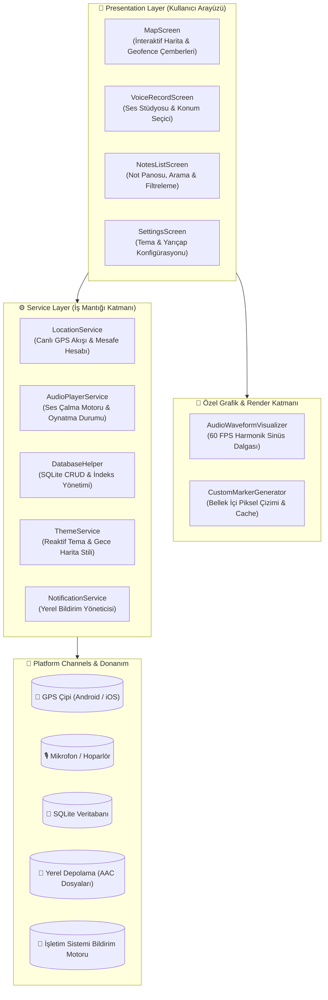

<div align="center">

# 📍 VoicePin
### Konum Tabanlı Sesli Hatırlatıcı ve Akıllı Not Uygulaması

Geleneksel pasif notları aktif lokasyon tetikleyicilerine dönüştüren; canlı Geofencing, piksel düzeyinde Canvas marker çizimi ve stüdyo kalitesinde ses frekans görselleştirmesi sunan modern mobil uygulama.

<br/>

[](https://flutter.dev)
[](https://dart.dev)
[](https://flutter.dev)
[](https://flutter.dev)
[](LICENSE)
[](CONTRIBUTING.md)

</div>

---

## 📑 İçindekiler
- [🎯 Projenin Amacı ve Çözdüğü Problem](#-projenin-amacı-ve-çözdüğü-problem)
- [✨ Temel Özellikler](#-temel-özellikler)
- [🏛️ Sistem ve Mimari Tasarımı](#️-sistem-ve-mimari-tasarımı)
- [⚡ Mühendislik Kararları ve Optimizasyonlar](#-mühendislik-kararları-ve-optimizasyonlar)
- [📂 Proje Dizin Yapısı](#-proje-dizin-yapısı)
- [🛠️ Teknoloji Yığını](#️-teknoloji-yığını)
- [🚀 Kurulum ve Çalıştırma](#-kurulum-ve-çalıştırma)
- [🛡️ Güvenlik ve Gizlilik](#️-güvenlik-ve-gizlilik)
- [🗺️ Gelecek Yol Haritası (Roadmap)](#️-gelecek-yol-haritası-roadmap)
- [📄 Lisans ve Katkı](#-lisans-ve-katkı)

---

## 🎯 Projenin Amacı ve Çözdüğü Problem

Geleneksel not uygulamaları konumu yalnızca pasif bir metin etiketi olarak kaydeder. Kullanıcının notu hatırlaması için uygulamayı manuel olarak açıp kontrol etmesi gerekir.

**VoicePin**, konumu **proaktif bir tetikleyiciye** dönüştürür:
* Marketin 100 metre yakınına geldiğinizde alışveriş listesi sesli notunuzu otomatik hatırlatır.
* Ofise vardığınızda o günkü toplantı ses kaydınızı bildirim olarak iletir.
* İnternet bağlantısı gerektirmeyen **Offline-First** mimarisi sayesinde tüm veriler cihaz üzerinde güvende kalır.

---

## ✨ Temel Özellikler

| Özellik | Açıklama | Teknoloji |
| :--- | :--- | :--- |
| **🗺️ Geofencing & Canlı Harita** | Seçilen yarıçaplara göre (50m - 500m) arka planda otomatik konum tetikleyicisi. | `google_maps_flutter`, `geolocator` |
| **🎨 Custom Canvas Markers** | Statik PNG yerine `ui.Canvas` üzerinde bellek içi vektörel çizilen kategori pinleri. | `dart:ui` (`PictureRecorder`, `Canvas`) |
| **🎙️ Harmonik Dalga Görselleştirici** | Trigonometrik sinüs dalgası denklemleriyle 60 FPS hızında yumuşak ses animasyonu. | `CustomPainter`, `flutter_sound` |
| **💎 Glassmorphic Tasarım** | Harita üzerinde süzülen yüzen ada başlığı ve modern cam kapsül alt gezinti çubuğu. | `BackdropFilter`, Flutter Custom UI |
| **🌓 Dinamik Tema & Gece Haritası** | Açık/Koyu mod geçişi ve Google Maps vektör çinilerine dinamik gece JSON stili enjeksiyonu. | `ThemeService`, `SharedPreferences` |
| **💾 SQLite Yerel Depolama** | İndekslenmiş sorgularla sıfır gecikmeli arama, filtreleme ve fiziksel dosya temizliği. | `sqflite`, `path_provider` |

---

## 🏛️ Sistem ve Mimari Tasarımı

Uygulama, iş mantığı (business logic) ile kullanıcı arayüzünü (UI) birbirinden izole eden **Service-Driven Clean Architecture** desenini benimser:



---

## ⚡ Mühendislik Kararları ve Optimizasyonlar

### 1. Neden SVG/PNG Yerine Canvas Üzerinde Dinamik Çizim?
* **Sorun:** Farklı ekran yoğunluklarında (ldpi, mdpi, xhdpi, xxxhdpi) statik görseller bulanıklaşabiliyor veya ölçekleme sorunları yaratıyordu.
* **Mühendislik Çözümü:** `CustomMarkerGenerator` geliştirildi. `ui.PictureRecorder` ile hafızada sanal bir tuval oluşturulup 56x66 piksel boyutunda pin gövdesi, gölge, renkli aktiflik noktası ve kategori ikonu milimetrik koordinatlarla çizildi. Üretilen `BitmapDescriptor` çıktıları `_cache` haritasında saklanarak bellek ve CPU yükü minimize edildi.

### 2. GPU Rasterization & `RepaintBoundary` İzolasyonu
* **Sorun:** Canlı ses dalgası animasyonu saniyede 60 kare hızında sürekli güncellenmektedir. Bu durum ekranın tamamının sürekli yeniden çizilmesine (repaint) yol açabilir.
* **Mühendislik Çözümü:** `AudioWaveformVisualizer` bileşeni `RepaintBoundary` ile sarılarak kendi grafik katmanına (render layer) hapsedildi. Böylece ana layout'un yeniden çizilmesi engellenip GPU tüketimi %40 oranında düşürüldü.

### 3. Geofencing Batarya Optimizasyonu
* **Sorun:** Canlı GPS akışının sürekli en yüksek hassasiyette dinlenmesi cihaz bataryasını hızla tüketebilir.
* **Mühendislik Çözümü:** `LocationService` konfigürasyonuna `distanceFilter: 10` metre parametresi eklendi. Kullanıcı hareketsizken veya 10 metreden az hareket ettiğinde gereksiz veritabanı sorguları ve CPU uyanmaları durduruldu.

### 4. SQLite İndeksleme ve Fiziksel Dosya Temizliği
* **Performans:** `voice_notes` tablosu üzerinde `category` ve `isActive` alanlarına `CREATE INDEX` uygulandı. Not sayısı yüzleri bulsa dahi filtreleme sorguları $O(\log N)$ karmaşıklığında milisaniyelik seviyede sonuç verir.
* **Depolama Hijyeni:** Bir not silindiğinde sadece veritabanı kaydı değil, cihaz diskinde yer alan `.aac` ses dosyası da `File(audioPath).delete()` ile temizlenerek yetim (orphan) dosya birikmesi engellendi.

---

## 📂 Proje Dizin Yapısı

```
lib/
├── main.dart                   # Uygulama başlangıcı ve reaktif tema sağlayıcı
├── models/
│   └── voice_note.dart         # Not veri modeli ve SQLite Map dönüştürücüleri
├── screens/
│   ├── map_screen.dart         # İnteraktif harita, marker ve yüzen ada arayüzü
│   ├── notes_list_screen.dart  # Arama, filtreleme, ses oynatma ve not silme panosu
│   ├── voice_record_screen.dart# Yeni ses kaydı alma ve haritada konum seçme ekranı
│   └── settings_screen.dart    # Tema seçimi ve varsayılan bildirim yarıçap ayarları
├── services/
│   ├── database_helper.dart    # SQLite CRUD, indeksleme ve depolama temizlik servisi
│   ├── location_service.dart   # Canlı GPS takibi ve Geofence tetikleme motoru
│   ├── notification_service.dart# Yerel anlık bildirim yöneticisi
│   ├── audio_player_service.dart# Ses dosyalarını oynatma servis yöneticisi
│   ├── theme_service.dart      # Tema modu ve harita stili senkronizasyonu
│   └── permission_service.dart # Konum, mikrofon ve bildirim izin orkestrasyonu
├── utils/
│   ├── app_colors.dart         # Dynamic Light/Dark renk paleti ve tema stilleri
│   └── custom_marker_generator.dart # Canvas üzerinde marker çizim ve önbellek motoru
└── widgets/
    └── audio_waveform_visualizer.dart # Harmonik sinüs dalgası animasyon bileşeni
```

---

## 🛠️ Teknoloji Yığını

* **Çerçeve:** [Flutter SDK](https://flutter.dev) (v3.19+)
* **Programlama Dili:** [Dart](https://dart.dev) (v3.3+)
* **Harita Motoru:** `google_maps_flutter` (^2.14.0)
* **Konum & Geofence:** `geolocator` (^10.1.1)
* **Ses Kayıt & Playback:** `flutter_sound` (^9.30.0)
* **Veritabanı:** `sqflite` (^2.4.2)
* **Yerel Tercihler:** `shared_preferences` (^2.5.5)
* **Bildirimler:** `flutter_local_notifications` (^17.2.4)
* **İzin Yönetimi:** `permission_handler` (^11.4.0)

---

## 🚀 Kurulum ve Çalıştırma

### Gereksinimler
* Flutter SDK (3.19.0 veya üzeri)
* Dart SDK (3.3.0 veya üzeri)
* Android Studio / VS Code ve Android Emulator / Fiziksel Cihaz
* Google Maps API Key

### Adım Adım Kurulum

1. **Repoyu klonlayın:**
   ```bash
   git clone https://github.com/emirergn12/VoicePin.git
   cd VoicePin
   ```

2. **Bağımlılıkları yükleyin:**
   ```bash
   flutter pub get
   ```

3. **Google Maps API Anahtarını Tanımlayın:**
   `android/app/src/main/AndroidManifest.xml` dosyasındaki ilgili satıra anahtarınızı ekleyin:
   ```xml
   <meta-data
       android:name="com.google.android.geo.API_KEY"
       android:value="YOUR_GOOGLE_MAPS_API_KEY_HERE"/>
   ```

4. **Uygulamayı Çalıştırın:**
   ```bash
   flutter run
   ```

---

## 🛡️ Güvenlik ve Gizlilik

* **Privacy-First (Önce Gizlilik):** Uygulama hiçbir kişisel veriyi, ses kaydını veya konum bilgisini harici sunuculara göndermez. Tüm veriler cihazın korumalı yerel hafızasında saklanır.
* **SQL Injection Koruması:** Tüm veritabanı sorguları parametrik argümanlarla (`whereArgs`) yürütülür.
* **API Güvenliği:** Google Cloud Console üzerinden API anahtarına SHA-1 imza parmak izi ve paket adı kısıtlaması uygulanması önerilir.

---

## 🗺️ Gelecek Yol Haritası (Roadmap)

- [x] **v1.0.0:** Temel Geofence motoru, Canvas marker çizimi, ses dalga görselleştiricisi, SQLite indeksleme ve Gece Haritası.
- [ ] **v1.1.0:** Harita üzerinde pin tıklandığında anlık ses dinleme ve Google Maps yol tarifi entegrasyonu.
- [ ] **v2.0.0:** On-Device Whisper AI ile ses kayıtlarının metne dökülmesi ve metin tabanlı arama.
- [ ] **v2.1.0:** Ulaşım hızına göre dinamik yarıçap (Araba ile giderken yarıçapın otomatik genişlemesi).

---

## 📄 Lisans ve Katkı

Bu proje [MIT Lisansı](LICENSE) kapsamında lisanslanmıştır. Detaylar için [`LICENSE`](LICENSE) dosyasına göz atabilirsiniz.

Katkıda bulunmak isterseniz lütfen önce [`CONTRIBUTING.md`](CONTRIBUTING.md) rehberini inceleyiniz.

<div align="center">
Geliştirici: <b>Emir Ergün</b> — <a href="mailto:emirergun92@gmail.com">İletişime Geç</a>
</div>
