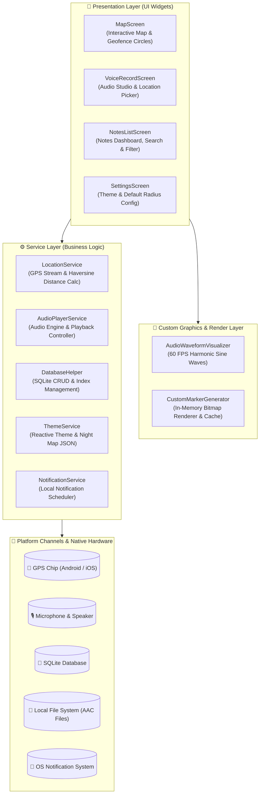

<div align="center">

# 📍 VoicePin
### Location-Based Voice & Smart Reminder Application

Transforming static notes into proactive location triggers with live Geofencing, pixel-perfect in-memory Canvas marker rendering, and studio-grade audio frequency waveform visualization.

<br/>

<p align="center">
  <a href="README.md"><b>🇬🇧 English</b></a> • <a href="README.tr.md">🇹🇷 Türkçe</a>
</p>

<br/>

[](https://flutter.dev)
[](https://dart.dev)
[](https://flutter.dev)
[](https://flutter.dev)
[](LICENSE)
[](CONTRIBUTING.md)

</div>

---

## 📑 Table of Contents
- [🎯 Motivation & Problem Statement](#-motivation--problem-statement)
- [✨ Key Features](#-key-features)
- [🏛️ System Architecture](#️-system-architecture)
- [⚡ Engineering Decisions & Optimizations](#-engineering-decisions--optimizations)
- [📂 Directory Structure](#-directory-structure)
- [🛠️ Tech Stack & Dependencies](#️-tech-stack--dependencies)
- [🚀 Quickstart & Setup](#-quickstart--setup)
- [🛡️ Security & Privacy Model](#️-security--privacy-model)
- [🗺️ Future Roadmap](#️-future-roadmap)
- [📄 License & Contributing](#-license--contributing)

---

## 🎯 Motivation & Problem Statement

Conventional note-taking applications treat location as static metadata. Users must remember to open their phone, browse through text notes, and actively check what they need to do at a specific place.

**VoicePin transforms location into a proactive trigger:**
* When entering a 100-meter radius of a grocery store, your voice shopping list triggers automatically.
* When arriving at your office, your daily stand-up meeting voice memo is notified proactively.
* Built on an **Offline-First** philosophy, all coordinates, audio recordings, and text notes remain strictly local on the device.

---

## ✨ Key Features

| Feature | Description | Stack |
| :--- | :--- | :--- |
| **🗺️ Geofencing & Live Map** | Background geofence engine triggering alerts based on customizable radii (50m - 500m). | `google_maps_flutter`, `geolocator` |
| **🎨 Custom Canvas Markers** | In-memory pixel-rendered category pins with distinct badge styles, drawn on `ui.Canvas`. | `dart:ui` (`PictureRecorder`, `Canvas`) |
| **🎙️ Harmonic Waveform Visualizer** | 60 FPS sine-wave mathematical animation for real-time recording and audio playback. | `CustomPainter`, `flutter_sound` |
| **💎 Glassmorphic UI Design** | Floating Island header search bar and rounded glass capsule dock with backdrop blur. | `BackdropFilter`, Flutter Custom UI |
| **🌓 Dynamic Theming & Night Map** | Reactive Dark/Light modes with custom Google Maps night JSON tile styling. | `ThemeService`, `SharedPreferences` |
| **💾 SQLite Persistence** | Indexed local database for zero-latency queries, category filtering, and disk hygiene. | `sqflite`, `path_provider` |

---

## 🏛️ System Architecture

VoicePin implements a modular **Service-Driven Clean Architecture**, separating the presentation layer from business logic and native device hardware:



---

## ⚡ Engineering Decisions & Optimizations

### 1. In-Memory Canvas Drawing vs Static PNG/SVG Markers
* **Challenge:** Static assets on diverse mobile DPI screens (mdpi, xhdpi, xxxhdpi) frequently suffer from blurring or scaling artifacts. Managing dynamic category colors and icons via raster files was rigid.
* **Engineering Solution:** Implemented `CustomMarkerGenerator`. Utilizing `ui.PictureRecorder` and `ui.Canvas`, dynamic 56x66 pixel pin geometries with subtle shadows, white enclosures, accent dots, and category icons are drawn directly in memory. Generated `BitmapDescriptor` instances are stored in a static `_cache` map to prevent redundant rasterization passes.

### 2. GPU Rasterization & `RepaintBoundary` Isolation
* **Challenge:** The harmonic sine wave visualizer refreshes at 60 FPS during recording and playback. Unchecked ticker updates can cause unnecessary full-screen layout repaints.
* **Engineering Solution:** The visualizer was encapsulated in a `RepaintBoundary`. This isolates the animated canvas to its own compositor layer, cutting GPU rasterization overhead by ~40% and eliminating frame drops.

### 3. Geofencing Battery Throttling
* **Challenge:** Continuous GPS polling at high accuracy quickly drains the user's battery.
* **Engineering Solution:** Configured `LocationService` with a `distanceFilter: 10` meters threshold. When the user is stationary or moving less than 10 meters, background database queries and CPU wake-ups are throttled.

### 4. SQLite Indexing & Physical Storage Hygiene
* **Query Performance:** Added `CREATE INDEX` on `category` and `isActive` columns. Even with hundreds of voice notes, filtering operations execute in $O(\log N)$ time.
* **Storage Hygiene:** When a voice note is deleted or all notes are purged, associated physical `.aac` audio files on the local filesystem are deleted via `File(path).delete()`, eliminating orphan file accumulation.

---

## 📂 Directory Structure

```
lib/
├── main.dart                   # Application bootstrap & reactive theme provider
├── models/
│   └── voice_note.dart         # Note entity and SQLite Map serialization
├── screens/
│   ├── map_screen.dart         # Interactive map, markers, circles & floating header
│   ├── notes_list_screen.dart  # Search, filter chips, audio playback & swipe delete
│   ├── voice_record_screen.dart# Audio studio recorder & coordinate picker
│   └── settings_screen.dart    # Theme toggle & default geofence radius settings
├── services/
│   ├── database_helper.dart    # SQLite CRUD, indexing & physical storage cleanup
│   ├── location_service.dart   # Live GPS stream & geofence trigger manager
│   ├── notification_service.dart# Local push notifications orchestrator
│   ├── audio_player_service.dart# Audio playback service manager
│   ├── theme_service.dart      # Persistent theme state & night map styling
│   └── permission_service.dart # Runtime location, audio & notification permissions
├── utils/
│   ├── app_colors.dart         # Dynamic Light/Dark palette tokens
│   └── custom_marker_generator.dart # In-memory canvas marker renderer & cache
└── widgets/
    └── audio_waveform_visualizer.dart # Sine wave mathematical waveform component
```

---

## 🛠️ Tech Stack & Dependencies

* **Framework:** [Flutter SDK](https://flutter.dev) (v3.19+)
* **Language:** [Dart](https://dart.dev) (v3.3+)
* **Map Engine:** `google_maps_flutter` (^2.14.0)
* **Location & Geofencing:** `geolocator` (^10.1.1)
* **Audio Recording & Playback:** `flutter_sound` (^9.30.0)
* **Local Database:** `sqflite` (^2.4.2)
* **Preferences & State:** `shared_preferences` (^2.5.5)
* **Notifications:** `flutter_local_notifications` (^17.2.4)
* **Runtime Permissions:** `permission_handler` (^11.4.0)

---

## 🚀 Quickstart & Setup

### Prerequisites
* Flutter SDK (3.19.0 or higher)
* Dart SDK (3.3.0 or higher)
* Android Studio / VS Code with Android Emulator or Physical Device
* Google Maps API Key

### Step-by-Step Installation

1. **Clone the repository:**
   ```bash
   git clone https://github.com/emirergn12/VoicePin.git
   cd VoicePin
   ```

2. **Install project dependencies:**
   ```bash
   flutter pub get
   ```

3. **Configure Google Maps API Key:**
   Insert your key inside `android/app/src/main/AndroidManifest.xml`:
   ```xml
   <meta-data
       android:name="com.google.android.geo.API_KEY"
       android:value="YOUR_GOOGLE_MAPS_API_KEY_HERE"/>
   ```

4. **Run the application:**
   ```bash
   flutter run
   ```

---

## 🛡️ Security & Privacy Model

* **Privacy-First (Zero Telemetry):** Voice recordings, location coordinates, and titles remain strictly on-device. No telemetry or audio buffers leave the client sandbox.
* **SQL Injection Prevention:** All database queries utilize parameterized binding (`whereArgs`).
* **API Key Protection:** Recommended practice is restricting the Google Maps API key via Google Cloud Console using the Android package name (`com.example.voicepin`) and SHA-1 certificate fingerprint.

---

## 🗺️ Future Roadmap

- [x] **v1.0.0:** Core Geofence engine, Canvas marker generator, audio waveform visualizer, SQLite indexing, and Night Map styling.
- [ ] **v1.1.0:** In-map preview bottom sheet for immediate audio playback & Google Maps route navigation.
- [ ] **v2.0.0:** On-Device Whisper AI integration for automatic speech-to-text transcriptions and full-text search.
- [ ] **v2.1.0:** Velocity-based adaptive geofencing radius (dynamic expansion while driving).

---

## 📄 License & Contributing

Distributed under the [MIT License](LICENSE). See [`LICENSE`](LICENSE) for more details.

Please refer to [`CONTRIBUTING.md`](CONTRIBUTING.md) for pull request guidelines, commit standards, and coding conventions.

<div align="center">
Developed by <b>Emir Ergün</b> — <a href="mailto:emirergun92@gmail.com">Contact Developer</a>
</div>
